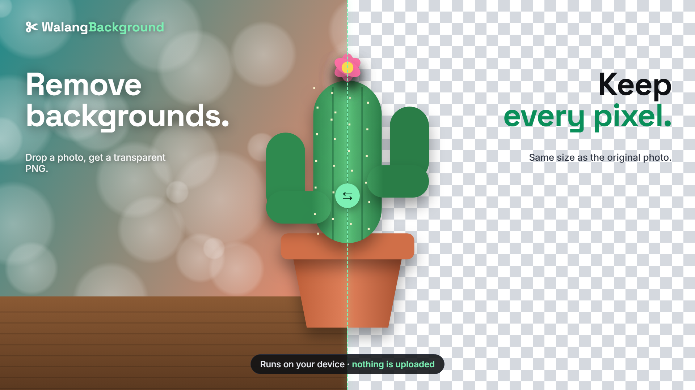
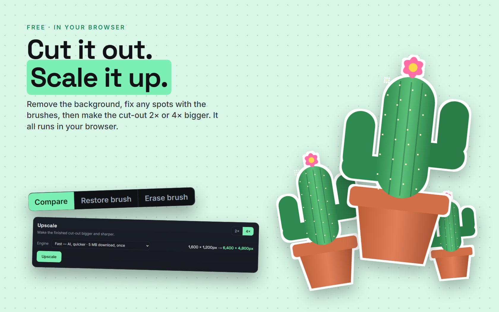

# WalangBackground

**A free background remover and image upscaler that runs in your browser.**

## About

WalangBackground removes the background from a photo and gives you a transparent PNG at the exact size of your original. It can also make a picture 2× or 4× bigger and sharper.

There is no account, no server and no upload. Your photos never leave your device. This project's repository is called dkCutout.

**[Try it: direkjames.github.io/dkCutout](https://direkjames.github.io/dkCutout/)**

## Features

- Drag and drop a photo, click to choose one, or paste it with **Ctrl+V** (PNG, JPG or WEBP)
- The cut-out is made on your own device, with no upload
- Download a **transparent PNG at the exact original size**
- **Before and after slider** to compare the photo and the result
- **Two quality modes** for the cut-out: Best for cleaner edges, and Fast for older phones and PCs
- **Subject solidity** slider to bring back faded parts, and an option to **fill small holes** inside the subject
- **Restore brush** to paint back anything the AI removed by mistake, and **Erase brush** to remove leftovers, with adjustable size, undo and reset
- **Upscale 2× or 4×**, on the cut-out or on its own with **Upscale only**, with three engines:
  - **Best:** AI upscaling with the sharpest detail. It needs a browser with WebGPU, and it is hidden where it would be far too slow.
  - **Fast:** AI upscaling that is quicker and a much smaller download
  - **Classic:** a plain smooth resize with nothing to download
- Big photos are upscaled in small pieces in the background, with a **Cancel** button and size limits that fit your device
- The AI files download once and are saved in your browser
- A built-in **How to use** guide

## Getting started

1. Open [direkjames.github.io/dkCutout](https://direkjames.github.io/dkCutout/) in your browser.
2. Choose **Remove background** or **Upscale only**, then drop in a photo or paste one.
3. Drag the slider to compare, and fix any spots with the brushes or the solidity slider.
4. Optional: open **Upscale**, pick 2× or 4× and an engine, and press **Upscale**.
5. Press **Download PNG**.

## Requirements

- A modern web browser (Chrome, Edge, Firefox or Safari). A browser with WebGPU is faster, and is needed for the Best upscaler.
- An internet connection the first time, to load the AI files

## Built with

- HTML, CSS and JavaScript, with no build step
- [@imgly/background-removal](https://github.com/imgly/background-removal-js) for the cut-out
- [Real-ESRGAN](https://github.com/xinntao/Real-ESRGAN) models, run with [ONNX Runtime Web](https://onnxruntime.ai/), for the AI upscaling
- GitHub Pages for hosting

Want to run it yourself? See [Developing WalangBackground](docs/DEVELOPING.md).

## Status

Shipped.

## Credits / License

Made by [direkjames](https://github.com/direkjames). See [LICENSE](LICENSE).

Upscaling uses Real-ESRGAN by Xintao Wang and others (BSD-3-Clause) and ONNX Runtime (MIT). The cut-out uses @imgly/background-removal, which is AGPL-3.0.
